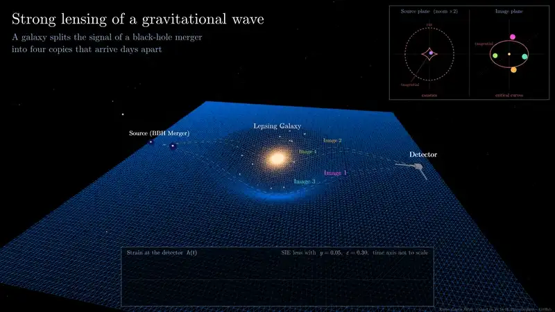
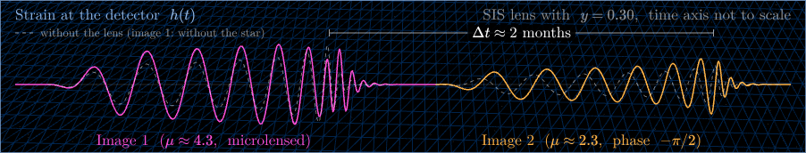
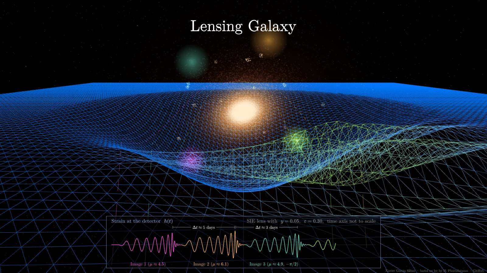

# Gravitational-wave lensing animation

An interactive 3D animation of a gravitational wave from a binary black hole merger that is lensed by a galaxy or a galaxy cluster on its way to a detector. It shows **strong lensing** (several copies of the same signal), **weak lensing** (one slightly magnified copy) and **microlensing** by a star (a frequency-dependent distortion), together with the caustics of the lens and the strain the detector records.

**[▶ Open the animation](https://xxaviergarcia.github.io/gw-lensing-animation/)**

*The Einstein cross scenario, seen from outside and then from the detector: four copies of the same signal arrive days apart. Click it to watch it in full quality, or download the [MP4](docs/video/gw-lensing-animation.mp4) (1080p, 26 s).*

## How to open it

- **Online:** <https://xxaviergarcia.github.io/gw-lensing-animation/>
- **Offline:** download [`index.html`](index.html) and open it in a web browser (Chrome, Firefox, Edge or Safari). Everything is in that one file; it only needs an internet connection to load [three.js](https://threejs.org).

## What is on screen

- **3D scene.** The binary (left), the lens (centre) and the detector (right) sit on a sheet that stands for spacetime. The wave leaves the binary in purple and splits into one coloured copy per image, each following its own path around the lens. The detector's arms stretch with the strain.
- **Caustics panel (top right).** Left: the source plane, with the caustics of the lens and the source (purple dot, which you can drag). Right: the image plane, with the critical curves and the images, each drawn with a size that grows with its magnification.
- **Waveform panel (bottom).** The strain at the detector, *h(t)*. Each copy is drawn over the signal the detector would get without the lens (dashed), labelled with its magnification *μ* and phase, and the real time delay between consecutive copies is written above them.
- **Explanation (top).** What the current scenario shows and what to look at. Click its title to fold it.

## Controls

| Control | What it does |
|---|---|
| **Scenario** menu | Loads a ready-made configuration (see below) |
| **Source position** *y* | Distance of the source from the lens axis, in units of the Einstein radius |
| **Lens ellipticity** *ε* | 1 − axis ratio of the lens; above 0 the central caustic opens into a diamond |
| Drag in the caustics panel | Moves the source anywhere on the source plane |
| **C** or *Switch to cluster* | Galaxy or galaxy cluster as the lens |
| **M** or *Microlensing* | Adds a star next to the path of image 1 |
| **O** or *Observer view* | Flies to the detector to see the images on the sky |
| **K**, **H** | Show or hide the caustics and waveform panels |
| **I** | Show or hide the explanation |
| **U** | Show or hide the control panel (for clean screen recordings) |
| **Space**, **R** | Pause or resume; replay from the start of the inspiral |
| *Copy link* | Copies a link that reopens the current configuration |
| Mouse | Drag to rotate the view, scroll to zoom |

## Scenarios

Every scenario has its own link, handy for slides or for sending to someone.

| Scenario | What it shows | Link |
|---|---|---|
| Two images behind a galaxy | The chirp arrives twice, two months apart; the second copy (a saddle point) is phase-shifted by −π/2 | [open](https://xxaviergarcia.github.io/gw-lensing-animation/?scenario=two-images) |
| Einstein cross: four images | An elliptical galaxy gives four images, all within about two weeks | [open](https://xxaviergarcia.github.io/gw-lensing-animation/?scenario=einstein-cross) |
| Near a fold caustic | Two very magnified images (*μ* ≈ 16) arriving about two hours apart | [open](https://xxaviergarcia.github.io/gw-lensing-animation/?scenario=fold) |
| Near a cusp | Three bright images bunched together, and a faint fourth one a month later | [open](https://xxaviergarcia.github.io/gw-lensing-animation/?scenario=cusp) |
| Almost perfect alignment | Both images near the Einstein ring, magnified more than 30 times | [open](https://xxaviergarcia.github.io/gw-lensing-animation/?scenario=alignment) |
| Galaxy cluster: years apart | Delays of years, and a faint central image with phase −π | [open](https://xxaviergarcia.github.io/gw-lensing-animation/?scenario=cluster) |
| Elliptical cluster: five images | The four images of a cross plus the central one | [open](https://xxaviergarcia.github.io/gw-lensing-animation/?scenario=cluster-five) |
| One weakly magnified image | Weak lensing: a single image with *μ* ≈ 1.4 | [open](https://xxaviergarcia.github.io/gw-lensing-animation/?scenario=weak) |
| Star next to image 1 | Microlensing: wave-optics distortion of one of two copies | [open](https://xxaviergarcia.github.io/gw-lensing-animation/?scenario=micro) |
| Star in an Einstein cross | Microlensing of one of four copies | [open](https://xxaviergarcia.github.io/gw-lensing-animation/?scenario=micro-cross) |

Any other configuration can be linked too, for example `?lens=cluster&y=0.3&e=0.2&phi=30&micro=1` (`phi` is the direction of the source in degrees). Add `view=observer` to start at the detector, and `ui=0`, `info=0`, `caustics=0` or `waveform=0` to hide panels.

| | |
|---|---|
|  |  |
| Microlensing: image 1 (pink) next to its dashed copy without the star | Observer view: the Einstein cross on the detector's sky |

## Strong, weak and microlensing in a nutshell

### Strong lensing

When the source lies close to the line of sight to a massive lens (inside its caustics), several paths from the source reach the detector and the lens forms **multiple images**. For a gravitational wave each image is a copy of the same signal, with

- its own **magnification** *μ*: the amplitude is multiplied by √|*μ*|;
- its own **arrival time**: galaxies give delays of hours to months, clusters of months to years;
- a **Morse phase** fixed by the image type: 0 for minima of the arrival time (type I), −π/2 for saddle points (type II) and −π for maxima (type III).

A galaxy usually gives two or four bright images; a lens with a flat core, like the cluster here, also has a faint central one. All copies share the same chirp and the same sky position, which is how lensed pairs are searched for in LIGO–Virgo–KAGRA data.

### Weak lensing

Most sources are far from any lens in projection. They have a **single image**, slightly magnified or demagnified by the matter along the line of sight. A weakly lensed signal cannot be recognised as lensed on its own, but since the amplitude scales as √*μ* / *D*L, the luminosity distance inferred from it is *D*L / √*μ*: an extra source of scatter when gravitational waves are used as standard sirens.

### Microlensing

Compact objects such as stars, stellar remnants or compact dark matter can lens a signal too. When the gravitational wavelength is comparable to the Schwarzschild radius of the lens, as for lenses of roughly 10 to 10⁴ solar masses at the frequencies of ground-based detectors, geometric optics breaks down: the amplification depends on frequency and the waveform shows beating patterns from the interference of micro-images. In the animation a star sits next to image 1 and distorts only that copy, computed with the exact point-mass amplification factor. The size of the effect is exaggerated so it can be seen.

The equations behind the animation are in [docs/physics.md](docs/physics.md).

## What is computed and what is a cartoon

**Computed** with the lens model: the image positions (2D lens equation), magnifications, image types and Morse phases, the order of arrival, the caustics and critical curves, the real time delays (for a lens at redshift 0.5 and a source at redshift 2) and the wave-optics microlensing amplification.

**Cartoon:** the spacetime sheet and the wave travelling on it, the shape of the chirp, and the time axis of the waveform panel, which is compressed so all copies fit on screen (the real delays are written above them). Distant sources are pulled in so they stay on the sheet; the caustics panel shows their true positions.

## A five-minute tour

1. **Two images behind a galaxy.** Two copies of one chirp, with different amplitudes and two months apart. Point out the −π/2 phase of the second copy.
2. **Drag the source outward** in the caustics panel. When it crosses the dashed circle the second image disappears; further out, the only image is barely magnified: weak lensing.
3. **Einstein cross**, then press **O**: four images on the detector's sky, flashing as their copies arrive.
4. **Near a fold caustic**: two images, both magnified about 16 times, arrive almost together.
5. **Galaxy cluster**: delays of years and a faint central image.
6. **Star next to image 1**: microlensing distorts one copy and leaves the other untouched.

## Adding a scenario

Everything lives in [`index.html`](index.html). Scenarios are entries of the `SCENARIOS` list near the top of the script: copy one, give it a new `id`, set the lens (`galaxy` or `cluster`), `y`, `e`, `phi` (degrees) and `micro`, and write its `text` and `look` lines. It then appears in the menu and opens with `?scenario=<id>`.

## Credits

The animation is based on the gravitational lensing animation in the documentation of [ler](https://ler.hemantaph.com) by Hemantakumar Phurailatpam (MIT License), adapted and extended by Xavier Garcia Sàbat.

It uses [three.js](https://threejs.org) (MIT License), loaded from a CDN, and embeds subsets of the Latin Modern Roman font (GUST Font License) and of the KaTeX Main and KaTeX Math fonts (SIL Open Font License 1.1).

The captions of the video use the CMU Serif font (SIL Open Font License 1.1).

## License and how to credit it

[MIT License](LICENSE): you can use, modify and share the animation freely, keeping the copyright notice.

If you use it, or a screenshot or recording of it, in a talk, poster, paper or video, please credit it, for example:

> Animation: X. Garcia Sàbat (2026), *Gravitational-wave lensing animation*, https://github.com/XxavierGarcia/gw-lensing-animation, based on ler by H. Phurailatpam.

The *Cite this repository* button on GitHub (from [`CITATION.cff`](CITATION.cff)) gives the reference in APA and BibTeX.
